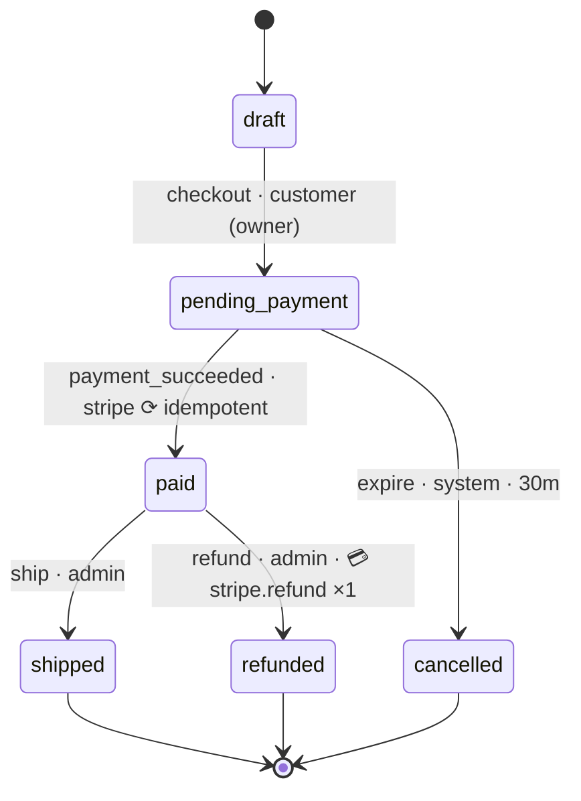
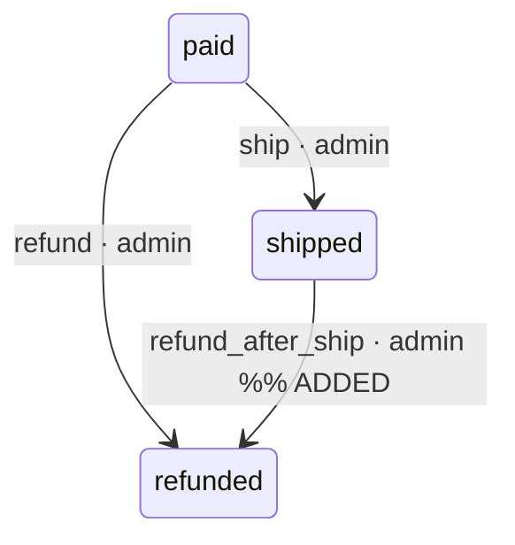

# 2. Pivot: Code + Behavior Spec, Verified Against Each Other

> Status: draft v0.2 · Replaces the claims ledger from [1. proposal.md](./1.%20proposal.md)
> Open questions in §11 are answered in [3. decisions-and-answers.md](./3.%20decisions-and-answers.md)
> Working name: **`tsv`** · First target: TypeScript

---

## 0. What changed from v0.1

| v0.1 (claims ledger) | v0.2 (behavior spec) |
|---|---|
| Humans write or ratify many small claims | **The agent writes the spec** as a second output, alongside the code |
| Evidence spread across a ledger of YAML records | **One behavior file per feature or entity**, stored next to the code |
| Reviewers read claim text | Reviewers **look at a rendered diagram** and a behavior diff |
| Formal tools sit behind many separate checks | The behavior file **compiles to a formal model**. The code is then checked for conformance to that model |

The human role is now: **look at the picture and decide whether it is what you wanted.** They no longer author statements.

---

## 1. Core loop

```
   ┌──────────────────────── agent task ────────────────────────┐
   │                                                            │
   ▼                                                            ▼
order.behavior.yaml   ◀────────── must agree ──────────▶   src/orders/*.ts
 (what should happen)                                     (what does happen)
   │                                                            │
   ├─▶ tsv view   → diagram, permission matrix, summary   (human reads this)
   ├─▶ tsv check  → ① spec is sound        (model checking: Quint/TLA+)
   │                ② code matches spec    (static extraction + generated tests)
   │                ③ failures replayed    (counterexample → failing TS test)
   └─▶ tsv diff   → behavior diff in the PR (what changed in *behavior*, not lines)
```

You can run it in two places:
- **While developing:** `tsv check` locally, or inside the agent's loop (CLI or MCP). The agent iterates until the check is green.
- **In PRs:** a CI check plus a PR comment with the rendered **behavior diff** (Mermaid renders natively on GitHub).

---

## 2. The behavior file

### 2.1 Requirements

1. **Readable without reading code.** Uses domain words, not implementation words.
2. **Visualizable.** The format is structural (states, transitions, actors, effects), so diagrams can be generated deterministically. They are not drawn by an LLM.
3. **Formally checkable.** Every construct has a precise meaning and compiles to a Quint/TLA+ model.
4. **Linked to code.** Every transition names its implementation, and broken links are errors.
5. **Easy for agents to write.** It is YAML with a JSON Schema, so agents get validation and autocomplete.
6. **Diffable.** Small, stable structure gives a meaningful PR diff.

### 2.2 Example: `src/orders/order.behavior.yaml`

```yaml
behavior: Order lifecycle
summary: A customer checks out and pays; an admin ships or refunds; unpaid orders expire.

entity:
  name: Order
  state: status                         # the field in code that holds the state
  states: [draft, pending_payment, paid, shipped, refunded, cancelled]
  initial: draft
  terminal: [shipped, refunded, cancelled]

actors:
  customer: { trust: untrusted }
  admin:    { trust: authenticated, requires: role(admin) }
  stripe:   { trust: signed-webhook }
  system:   { trust: internal }

transitions:
  checkout:
    from: draft
    to: pending_payment
    by: customer
    requires: [owner]                   # customer must own the order
    impl: src/orders/checkout.ts#checkout

  payment_succeeded:
    from: pending_payment
    to: paid
    by: stripe
    idempotent: true                    # webhook may be delivered more than once
    impl: src/payments/webhook.ts#onPaymentSucceeded

  expire:
    from: pending_payment
    to: cancelled
    by: system
    after: 30m
    impl: src/jobs/expireOrders.ts#expireOrders

  ship:
    from: paid
    to: shipped
    by: admin
    impl: src/admin/orders.ts#shipOrder

  refund:
    from: paid
    to: refunded
    by: admin
    effects:
      - stripe.refund: exactly-once
    atomic: true                        # concurrent refunds must not both succeed
    impl: src/orders/refund.ts#refundOrder

rules:
  - name: Refund issued at most once per order
    always: count(effect stripe.refund) <= 1
  - name: Unpaid orders don't linger
    eventually: status != pending_payment

concurrency:
  max_parallel: { refund: 2, payment_succeeded: 2 }   # bounds for model checking
```

### 2.3 What a human sees (`tsv view` or the PR comment)



Other generated views:
- **Permission matrix:** actor × transition (who can do what). Untrusted actors are highlighted.
- **Effects table:** which transitions touch external systems, with their guarantees (once, idempotent).
- **Plain-English summary:** produced deterministically from the structure, not freeform LLM prose.
- **Counterexample playback:** a step-by-step sequence diagram of any violation.

---

## 3. How `tsv check` verifies

### ① The spec is sound (no human statements needed)

The behavior file compiles to Quint, and Apalache checks it. Two kinds of property are checked.

**Built-in properties.** These apply to every spec without anyone writing them:
- Every state is reachable, and every non-terminal state has a way out (no stuck states).
- Every transition by an `untrusted` actor has a `requires` guard.
- Every external effect is declared `exactly-once`, `idempotent`, or `at-least-once`. Under the declared concurrency, the model checker verifies that the guarantee holds given the `atomic` flags.
- Every webhook or retried transition is `idempotent`.

**Spec-specific `rules`.** These are written by the agent and visible to the human in the summary.

This catches design bugs **before any code exists**. For example: "refund isn't atomic, so with 2 parallel callers `stripe.refund` fires twice."

### ② The code matches the spec (static, seconds)

The TypeScript compiler API **extracts the behavior the code actually implements** and diffs it against the spec:

| Check | How |
|---|---|
| **Undeclared transitions** | Find every write to the state field: ORM adapters (Prisma, Drizzle, TypeORM), plain assignment, and raw SQL patterns. Infer the **from-state** using TypeScript's own control-flow narrowing: if `status` is a literal union, its narrowed type at the write site is the set of possible prior states. A write that isn't in the spec is an error |
| **Missing transitions** | A spec transition whose `impl` never writes the target state |
| **Guards** | `requires` maps to configured guard functions (`role(admin)` → `requireRole('admin')`). Dominance analysis on the control-flow graph checks that the guard runs before the write on **every** path |
| **Effects** | The `impl` call graph is scanned for calls to declared external clients. An undeclared effect, or a declared effect that is never called, is an error |
| **Atomicity** | If a transition is marked `atomic`, the read and write of the state must be one conditional update, a transaction, or a lock. Separate `await`s are flagged as a race |
| **Broken links** | `impl:` symbols must exist. Renames are caught |

The result is a **graph diff**: the code's graph versus the spec's graph.

### ③ Generated tests and replay (dynamic, seconds to minutes)

- **Path tests:** for every spec transition, drive `impl` from the `from` state and assert the `to` state plus the declared effects. Uses the project's existing test runner (vitest/jest) with fakes for declared effects.
- **Forbidden-transition tests:** for every (state, transition) pair the spec does *not* allow, assert that the call is rejected.
- **Guard tests:** call each transition as each actor that isn't permitted, and assert denial.
- **Counterexample replay:** any model-checker trace becomes a deterministic test that forces the same interleaving against the real functions. If it fails, the bug is real. If it passes, the spec or the extraction was wrong, which is also reported.

### Example output

```
$ tsv check src/orders
Order lifecycle  (src/orders/order.behavior.yaml)
  ✔ spec       6 states · 5 transitions · reachable · no stuck states   (apalache, depth 15)
  ✗ structure  src/admin/orders.ts:42 sets status "pending_payment" from {paid}
               → transition not in spec (paid → pending_payment)
  ✗ guard      refund: requireRole('admin') does not dominate write at src/orders/refund.ts:19
               (path via early-return branch at :14 skips the check)
  ✗ atomic     refund: read :12 and write :19 are separate awaits; spec says atomic
               → model: 2 parallel refunds ⇒ stripe.refund ×2 (violates "at most once")
               → replay: .tsv/generated/order.refund.race.test.ts   FAILS ✗ (confirmed)
  ✔ tests      18 path · 22 forbidden · 9 guard tests pass
3 violations · 2.8s static · 41s model
```

---

## 4. PR experience: the behavior diff

When a PR changes behavior, `tsv diff` posts:



> **Behavior changes in this PR**
> - ➕ New transition `shipped → refunded` (`refund_after_ship`, admin)
> - ⚠️ New transition has effect `stripe.refund` but no `returns.received` precondition
> - ✔ Code conforms to updated spec · 0 undeclared transitions

The reviewer approves the **behavior change** by looking at one diagram and a few bullet points. Line-by-line review of the TypeScript becomes optional for behavior, though it is still useful for style and performance.

There is also a useful signal in the opposite case: **a code change with no spec change that the extractor says alters the behavior graph** is flagged automatically.

---

## 5. Agent integration

Instructions shipped as an `AGENTS.md` / `CLAUDE.md` snippet, plus an MCP server:

1. **Spec first.** When a task changes behavior, edit or create the `*.behavior.yaml` first.
2. Optionally pause for a human glance at `tsv view`. This is the cheapest possible review point.
3. Write the code.
4. Run `tsv check` and iterate until green. Failures come back as failing tests, which is very good feedback for an agent.
5. The PR contains both outputs, and CI re-verifies them.

**Independence safeguards.** The same agent writing both outputs is the obvious weakness. These measures address it:
- The extractor derives the code's behavior **independently** from the code itself. The agent can't simply assert conformance.
- Built-in properties don't depend on what the agent chose to write.
- The human review surface is small and visual, so intent mismatches are easy to spot.
- Optional: a second agent, given **only the ticket and the diagram**, flags mismatches with the intent.

---

## 6. Existing codebases: `tsv infer`

To adopt this without writing specs by hand:

1. `tsv infer src/orders` runs the static extractor and **generates an as-is behavior file** from what the code actually does. It is marked `inferred: true`.
2. `tsv view` renders it. **Surprises in the diagram are often bugs**, for example "why can a `paid` order go back to `pending_payment`?"
3. A human or agent edits the inferred file into the intended behavior and removes `inferred`. From then on it is enforced.
4. Hotspot ranking points `infer` first at entities that have a state field, status unions, webhooks, and money or permission logic.

---

## 7. Where TLA+, Lean and Bend 2 fit now

| Tool | Role in v0.2 |
|---|---|
| **Quint → Apalache** (TLA+ semantics) | The compile target for `transitions`, `rules`, and `concurrency`. Users never have to write it; `tsv` can emit `.qnt` / `.tla` for experts |
| **TLC / TLAPS** | Optional: exhaustive checking or proofs for small, critical specs |
| **Lean 4** | Phase 3, for a future `decisions:` section (pricing tables, permission policies). It would prove properties such as "deny overrides allow" or "discounts never exceed 100%" on the spec's rule tables, then use differential testing to link them to the TypeScript |
| **Z3 / SMT** | Cheap completeness and overlap checks on decision tables and guards ("is there an input no rule covers?") |
| **Bend 2** | Still a trial: a candidate backend for the `decisions:` proofs and fast oracle execution. Kept off the critical path |

---

## 8. Scope: what behavior files can describe

| Phase | Section | Covers |
|---|---|---|
| **MVP** | `entity` + `transitions` + `rules` + `concurrency` | State machines over persisted entities. This covers most business-logic bugs: illegal transitions, missing authorization, races, double effects, idempotency |
| Next | `flows:` | Request pipelines (validate → authorize → effects → respond), rendered as sequence diagrams. Taint and authorization ordering checks |
| Later | `decisions:` | Decision tables and pure rules, checked with SMT and Lean |
| Later | `data:` | Cross-entity invariants ("an invoice total equals the sum of its line items") |

---

## 9. MVP plan

1. **Schema:** JSON Schema for `*.behavior.yaml` (entity, transitions, actors, effects, rules, concurrency).
2. **`tsv view`:** Mermaid and HTML rendering, plus the permission matrix and plain-English summary.
3. **Compiler:** behavior file → Quint, plus built-in properties. Run Apalache and parse the ITF counterexamples it returns.
4. **Extractor:** Prisma first (most common), plus plain field assignment. From-state inference via type narrowing, guard dominance, and effect call-graph scanning.
5. **Test generation:** path, forbidden-transition and guard tests, plus counterexample replay (vitest).
6. **`tsv diff`** and a GitHub Action that posts the behavior diff as a PR comment.
7. **Demo repo:** a small order/payments app with seeded bugs (illegal transition, skipped guard, refund race, non-idempotent webhook). Success means all of them are caught with a replay test, in under 60 seconds.

---

## 10. Risks

- **Extraction precision.** Dynamic property access, ORMs without adapters, and state spread across tables can all defeat it. Mitigation: start with Prisma and typed literal unions, and report "couldn't analyze" explicitly rather than guessing.
- **Spec expressiveness versus readability.** Every feature added to the format makes it harder to read. Keep the MVP to state machines, and add new sections only when real repos need them.
- **Agent writes a spec that matches buggy intent.** No tool fixes wrong intent. The goal is to make intent **cheap to see**, so the human catches it in seconds.
- **Replay needs injectable I/O.** Generated tests need fakes for the DB and effects. Prisma and a test database make this realistic for the MVP.

---

## 11. Open questions

1. **Format:** YAML (more readable, works across languages) or a TypeScript DSL (type-checked `impl` links, so renames are refactor-safe)? Current lean: YAML, with links validated by the indexer.
2. **Target stack for the MVP extractor:** Prisma? Drizzle? Something else in your codebases?
3. **Strictness:** should violations **block** PRs from day one, or be advisory until a spec is promoted to "enforced"?
4. **Visualization surface:** is Mermaid in PR comments enough, or do we want a local interactive viewer (`tsv view --serve`) with counterexample playback?
5. **Granularity:** one file per entity, or per feature/workflow when a workflow spans several entities?
