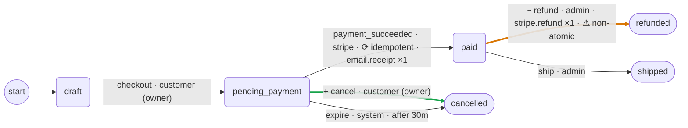

<!-- tsverify-diff -->
## Behavior diff

`HEAD` → working tree: 1 of 1 behavior file changed.

### Order lifecycle · changed

`src/orders/order.behavior.yaml` · +1 transition, ~1 transition

+ added · − removed · ~ changed · thick arrow: added · dotted arrow: removed · stadium: terminal state

**Transitions**

| | Transition | Change |
|---|---|---|
| + | `cancel` | from: `pending_payment` to: `cancelled` by: `customer` requires: `owner` atomic: `yes` concurrency: `2` |
| ~ | `refund` | atomic: `yes` → `no` |
