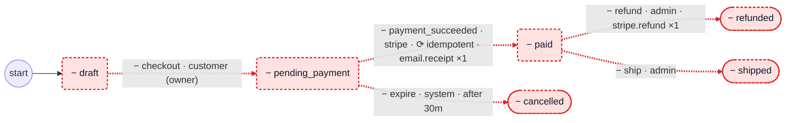
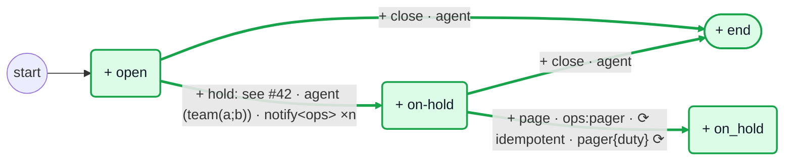

<!-- tsv-diff -->
## Behavior diff

`HEAD~1` → HEAD: 2 of 2 behavior files changed.

### Order lifecycle · removed

`a.behavior.yaml` · −6 states, −5 transitions, −4 actors, −3 rules, −8 bindings

+ added · − removed · ~ changed · thick arrow: added · dotted arrow: removed · stadium: terminal state

Everything the removed file declares

**Behavior**

| | Field | Change |
|---|---|---|
| − | `behavior` | `Order lifecycle` |
| − | `name` | `Order` |
| − | `state` | `status` |
| − | `initial` | `draft` |

**States**

| | State | Change |
|---|---|---|
| − | `cancelled` | terminal: `yes` |
| − | `draft` | removed |
| − | `paid` | removed |
| − | `pending_payment` | removed |
| − | `refunded` | terminal: `yes` |
| − | `shipped` | terminal: `yes` |

**Transitions**

| | Transition | Change |
|---|---|---|
| − | `checkout` | from: `draft` to: `pending_payment` by: `customer` requires: `owner` atomic: `yes` impl: `src/orders/checkout.ts#checkout` concurrency: `2` |
| − | `expire` | from: `pending_payment` to: `cancelled` by: `system` atomic: `yes` after: `30m` impl: `src/jobs/expire-orders.ts#expireOrder` concurrency: `2` |
| − | `payment_succeeded` | from: `pending_payment` to: `paid` by: `stripe` effects: `email.receipt (exactly-once)` atomic: `yes` idempotent: `yes` impl: `src/payments/webhook.ts#onPaymentSucceeded` concurrency: `2` |
| − | `refund` | from: `paid` to: `refunded` by: `admin` effects: `stripe.refund (exactly-once)` atomic: `yes` impl: `src/orders/refund.ts#refundOrder` concurrency: `2` |
| − | `ship` | from: `paid` to: `shipped` by: `admin` atomic: `yes` impl: `src/admin/orders.ts#shipOrder` concurrency: `2` |

**Actors**

| | Actor | Change |
|---|---|---|
| − | `admin` | trust: `authenticated` requires: `role(admin)` |
| − | `customer` | trust: `untrusted` |
| − | `stripe` | trust: `signed-webhook` |
| − | `system` | trust: `internal` |

**Rules**

| | Rule | Change |
|---|---|---|
| − | `Refund issued at most once per order` | kind: `always` expr: `count(effect stripe.refund) <= 1` |
| − | `Shipped orders are never refunded` | kind: `never` expr: `status == shipped and count(effect stripe.refund) > 0` |
| − | `Unpaid orders don't linger` | kind: `eventually` expr: `status != pending_payment` |

**Bindings**

| | Binding | Change |
|---|---|---|
| − | `client:db` | `src/db.ts#db` |
| − | `client:email` | `src/notify/email.ts#email` |
| − | `client:stripe` | `src/payments/stripe.ts#stripe` |
| − | `effect:email.receipt` | `email.send` |
| − | `effect:stripe.refund` | `stripe.refunds.create` |
| − | `guard:owner` | `src/auth/guards.ts#requireOwner` |
| − | `guard:role(admin)` | `src/auth/guards.ts#requireRole("admin")` |
| − | `persistence` | `assign` |

### Ticket: support \#1 · added

`b.behavior.yaml` · +4 states, +3 transitions, +2 actors, +1 rule

+ added · − removed · ~ changed · thick arrow: added · dotted arrow: removed · stadium: terminal state

Everything the added file declares

**Behavior**

| | Field | Change |
|---|---|---|
| + | `behavior` | `Ticket: support #1` |
| + | `name` | `SupportTicket` |
| + | `state` | `status` |
| + | `initial` | `open` |

**States**

| | State | Change |
|---|---|---|
| + | `end` | terminal: `yes` |
| + | `on-hold` | added |
| + | `on_hold` | added |
| + | `open` | added |

**Transitions**

| | Transition | Change |
|---|---|---|
| + | `close` | from: `on-hold, open` to: `end` by: `agent` atomic: `yes` concurrency: `1` |
| + | `hold: see #42` | from: `open` to: `on-hold` by: `agent` requires: `team(a;b)` effects: `notify<ops> (at-least-once)` atomic: `yes` concurrency: `1` |
| + | `page` | from: `on-hold` to: `on_hold` by: `ops:pager` effects: `pager{duty} (idempotent)` atomic: `yes` idempotent: `yes` concurrency: `1` |

**Actors**

| | Actor | Change |
|---|---|---|
| + | `agent` | trust: `authenticated` |
| + | `ops:pager` | trust: `internal` |

**Rules**

| | Rule | Change |
|---|---|---|
| + | `Closed tickets stay paged at most once` | kind: `always` expr: `status == end implies count(effect pager{duty}) <= 1` |

