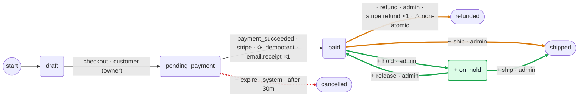

<!-- tsv-diff -->
## Behavior diff

`origin/main` → working tree: 1 of 2 behavior files changed.

### Order lifecycle · changed

`src/orders/order.behavior.yaml` · enforced · ~1 top-level field, +1 state, +2 transitions, −1 transition, ~2 transitions, −1 rule, ~1 binding

+ added · − removed · ~ changed · thick arrow: added · dotted arrow: removed · stadium: terminal state

**Behavior**

| | Field | Change |
|---|---|---|
| ~ | `enforced` | `no` → `yes` |

**States**

| | State | Change |
|---|---|---|
| + | `on_hold` | added |

**Transitions**

| | Transition | Change |
|---|---|---|
| − | `expire` | from: `pending_payment` to: `cancelled` by: `system` atomic: `yes` after: `30m` impl: `src/jobs/expire-orders.ts#expireOrder` concurrency: `2` |
| + | `hold` | from: `paid` to: `on_hold` by: `admin` atomic: `yes` concurrency: `1` |
| ~ | `refund` | atomic: `yes` → `no` |
| + | `release` | from: `on_hold` to: `paid` by: `admin` atomic: `yes` concurrency: `1` |
| ~ | `ship` | from: `paid` → `on_hold, paid` |

**Rules**

| | Rule | Change |
|---|---|---|
| − | `Unpaid orders don't linger` | kind: `eventually` expr: `status != pending_payment` |

**Bindings**

| | Binding | Change |
|---|---|---|
| ~ | `effect:stripe.refund` | `stripe.refunds.create` → `stripe.refunds.createV2` |

Unchanged: `src/other.behavior.yaml`.
